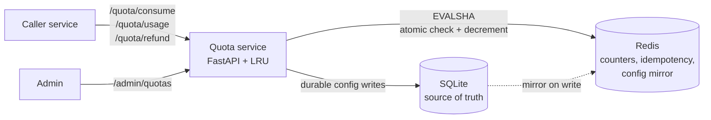

# DESIGN.md — Per-Customer Quota Metering

This document captures the design decisions, the reasoning behind them, the trade-offs that were rejected, measured load-test numbers across four scenarios, and the places where the system falls over.

## Integration shape

The quota component is a FastAPI service with three surfaces:

- `/admin/quotas` — admin path for upserting quota configs. Durable, infrequent.
- `/quota/{consume,refund,usage}` — the primitive surface. Callers are backend services, not end users.
- `/demo/{track-containers,search-schedule}` — a test harness that models a product-API caller of the quota service. Includes `demo_retry_key` and `simulate_failure` knobs to exercise retry-safety and failure-refund paths via curl.

Why a service and not a library: multiple backend services need to consume the same shared counter, so the state has to live outside any single caller. A library would still need a shared store — this is just acknowledging that reality in the deployment shape.

## High-level architecture



**Read path:** instance checks in-process LRU → Redis config mirror → SQLite (cold-start only). **Write path (consume):** one EVALSHA on Redis atomically reads the limit, checks remaining, INCRBYs if it fits, and stamps the idempotency record. **Admin writes:** SQLite is source of truth; the Redis mirror and all instance LRUs converge within 5 minutes.

## Storage split

Two stores, each with a clear job:

- **SQLite** — source of truth for quota configs. Durable, rarely written (admin updates only).
- **Redis** — hot path for counters, idempotency records, and a fast-read mirror of the config.

Why SQLite over Postgres: this service has a small schema, admin-only writes, and no cross-service transactions. SQLite with WAL mode handles it fine, bootstraps instantly in Docker, and has zero operational overhead. In production at 50,000 orgs this would move to Postgres; the migration is straightforward because the config access path is one function (`_get_limit`).

Why Redis for counters and idempotency, not SQLite: we need atomic check-and-decrement at 2,000+ rps per org. SQLite serializes writes through a single writer lock; Redis gives us per-key atomicity through Lua scripts running on its single command loop.

## Concurrent correctness

**Chosen: Redis + Lua script** for atomic check-and-decrement.

The entire consume path is one `EVALSHA` call that runs:
1. Read the used counter
2. Compare `used + n` against the limit
3. INCRBY if it fits, deny if it doesn't
4. Stamp the idempotency record

All of that happens inside Redis's single command loop. From the moment the script starts to the moment it returns, no other Redis command — from any client, on any connection — can execute. This is the atomicity guarantee: two concurrent consumes cannot both see "room for 100" and both deduct.

The Lua is passed `limit` as ARGV (not read from Redis) so the script touches only the counter and idempotency keys. This keeps it Cluster-compatible later with minimal changes (hash-tag the keys on `{org:feature}` and the script works unchanged).

**What we rejected and why:**

- **Database transactions with row locking.** Correct, but concentrates all concurrent writes on one row's lock. At 10k rps on a single hot row (scenario c), the lock wait time dominates. Redis's single command loop also serializes, but at microsecond granularity, not millisecond.
- **Optimistic concurrency control (CAS loops).** Works at low contention. Degrades catastrophically under high contention — every loser retries, which creates a retry storm. A scenario like 500 units with 500 simultaneous requests on the same counter is exactly where CAS falls apart.
- **Per-instance counting with periodic reconciliation.** Can't achieve "exactly 0 remaining, never over-served" without a central coordinator. Stateless horizontal scaling also rules this out — instances come and go, their local counters go with them.

**Proof:**

- `tests/test_concurrency.py::test_never_overserves_under_contention` — 1,000 concurrent consumes against a 500-unit quota, exactly 500 allowed, exactly 500 denied, counter lands at 500.
- Locust scenario c — 50 clients hammering one `(org, feature)` counter for 60 seconds: 252,781 consume requests, 0 errors, server-side p99 = 6ms.

## Batch behavior

**Chosen: all-or-nothing.** If `n` exceeds remaining, the whole batch is denied. No partial fulfillment.

Why: the caller has one logical operation ("track these 100 containers"). Partially allowing 30 of them makes the caller's bookkeeping ugly — they have to figure out which 30 succeeded, retry 70, and reconcile. Denying the whole batch is cleaner and matches how real callers think about retries: "if it didn't fit, I'll try again later or hit the pay-wall."

Trade-off: an org at 495/500 cannot consume a batch of 10, even though 5 units would fit. This is intentional. If "just use what's available" semantics were needed, the caller can retry with a smaller `n` — the quota service shouldn't guess their business logic.

## Failure & retries

Two distinct failure modes:

**1. Downstream operation fails after consume succeeded.**

Handled by refund. The consume call stamps `n_consumed` and `(org, feature, durations)` into the idempotency hash. The refund call takes only the idempotency key and uses the stamped context to decrement the right counter by the right amount. Refund is idempotent — a `refunded` flag on the idem hash makes repeat refunds no-ops.

**2. Client retries because the response was lost.**

Handled by the idempotency key. First call with a given key does the work and stamps the result. Any retry with the same key within 24h returns the stamped answer without touching the counter. First call writes the stamp, subsequent calls bounce off it — the counter moves exactly once.

Denials are also stamped. If the first consume was denied, retries return the same denial — not a re-evaluated answer. This prevents the drift where a transparent retry succeeds on round two because someone refunded in between. Clients signal "this is a new operation, not a retry" by generating a new UUID.

The idempotency TTL is 24h — long enough for any reasonable automatic retry pipeline, short enough to bound Redis memory. Documented limit: retries beyond 24h are treated as fresh requests.

**What we rejected:**

- **Reserve-then-commit two-phase.** Adds latency and a new failure mode (reservations leaked by crashed callers). Refund is simpler and solves the same problem without a reservation TTL to manage.
- **Client-side idempotency logic.** The service enforces the quota, which includes retry safety. Pushing this to callers means every caller reimplements it, and some will get it wrong.

**Proof:**

- `tests/test_concurrency.py::test_idempotency_replay_under_contention` — 100 concurrent calls with the same key, counter moves once.
- `tests/test_concurrency.py::test_refund_restores_counter` — consume → refund → state restored, second refund is a no-op.
- `smoke.sh` steps 8 and 9 — end-to-end retry and failure-refund demonstrations through the demo endpoint.

## Reset & reporting

**Chosen: rolling 30-day window anchored on first use.**

Why rolling, not calendar:
- A calendar reset (e.g., "1st of each month, UTC") creates a thundering herd at the reset boundary. Every org's counter resets at the same instant.
- Calendar is also unfair to late signups: an org that signs up on the 28th gets 2 days of quota before their first "month" ends.
- Rolling, anchored on first use, naturally staggers the resets across the org population, and every org gets a full 30 days from whenever they start using the feature.

Implementation: the counter key gets a 30-day TTL set only on the *first* INCRBY (checked via `PTTL == -1`). Subsequent consumes don't touch the TTL — otherwise the window would slide forever. When Redis deletes the key at TTL expiry, the next consume reads `GET` → `nil` → `used = 0`, and a fresh 30-day window begins. No cron, no reset job, no race condition.

**The usage endpoint** (`GET /quota/usage?org_id=…&feature=…`) returns:

```json
{
  "org_id": "...",
  "feature": "...",
  "duration": "MONTHLY",
  "quota": 500,
  "used": 100,
  "remaining": 400,
  "resets_at": "2026-12-08T19:52:38.825036+00:00"
}
```

`resets_at` is derived from Redis's PTTL on the counter key. If the counter doesn't exist yet (fresh org), `resets_at` is `null` — the window begins on first consume, not before.

Timezone: always UTC. No per-org timezone configuration. Timezone handling is a UX problem, not a quota problem; the counter has no concept of where the user is.

## State sharing across instances

All state that matters at request time lives in Redis:
- Counter: `quota:used:{org}:{feature}:{duration}`
- Idempotency: `quota:idem:{key}`
- Config mirror: `quota:config:{org}:{feature}:{duration}`

SQLite holds durable config, but request-path code never reads it when Redis has the mirror. The read chain is **LRU → Redis config mirror → SQLite**. In production with Zipfian access (a few hot orgs dominate), the LRU absorbs most traffic. Under uniform random access against the full 150k keyspace the LRU hit rate drops to ~7%, but the measured impact is negligible (scenario d: p99 2ms) because the Redis config mirror is <1ms — missing LRU just means one extra Redis GET, not a SQLite hit.

Config changes propagate on a 5-minute staleness bound (LRU TTL). This is documented, not fixed by invalidation events, because admin updates are rare and real-time propagation is not a stated requirement. A production deployment would add Redis pub/sub for immediate invalidation.

Instances come and go without issue: they share no local state that affects correctness. The LRU is a performance cache, not a source of truth. An instance starting cold just pays Redis config reads for the first few seconds until its LRU warms.

## Counter stores `used`, not `remaining`

Decision: counter value = units consumed this window. `remaining` is derived as `limit - used` at read time.

Why:
- **Config-independent.** Changing an org's limit mid-window doesn't require recalculating stored state. "347 used" is still "347 used" whether the limit is 500 or 1000.
- **Revocation works.** If an admin deletes the config, the next consume hits our "no active config" check and denies. If we stored `remaining`, old counter state would keep working until the window expired.
- **Natural refund semantics.** `DECRBY` is the obvious inverse of `INCRBY`. Storing `remaining` would mean "refund = INCRBY" and "window init = SET to limit" — more branches, more edge cases.
- **Fresh window is zero.** A missing counter key returns `nil` on GET, tonumber → 0. If we stored `remaining`, we'd have to initialize it to the current limit on first use, adding a branch and a potential race.

The cost: one Redis GET for the limit on the hot path. Absorbed by the LRU 95% of the time; otherwise a single same-rack round-trip (~0.5ms).

## Idempotency key ownership

The caller of `/quota/consume` is a backend service (demo routes in our test harness, a real product API in production). The caller **should** supply the idempotency key — one UUID per logical operation, reused across retries of that operation. That's the only way retry-safety is meaningful: the caller is the one who knows "this retry is the same work as the previous attempt."

If the caller omits the key, the service generates one and returns it in the response. This keeps the primitive safe to call from ad-hoc scripts and the `/docs` UI without silently falling back to a shared "empty key" slot (which would break both idempotency *and* refund for every such caller). It also preserves the refund path: a caller that got a generated key back can still call `/quota/refund` with it.

End users never see idempotency keys. They hit feature endpoints (`/demo/track-containers`) that generate keys internally. Exposing the key to end users would let them replay stale responses or confuse the retry-safety contract.

The `/demo/track-containers` endpoint accepts a `demo_retry_key` field, but this is explicit test-harness scaffolding — documented in the model's docstring. A production product-API endpoint would never expose this.

## Deployment

**Chosen: single-node Redis.**

For 2,000 sustained rps / 10,000 peak rps, a single Redis node has plenty of headroom. Modern Redis handles 100k+ ops/sec of simple commands on one core.

For 50,000 orgs:
- Memory: measured at launch scale (5k orgs × 30 features = 150k configs) was 17 MB. Linear scaling projects 1-year scale (50k × 30 = 1.5M configs) to ~170 MB. Plus idempotency records, which TTL out at 24h. Comfortably fits on any single Redis node.
- Throughput: 2k sustained is well within one node. Peak 10k is also fine on one node for commands this small (EVALSHA with 5-10 Redis ops inside).

If Redis becomes the bottleneck:
- Move to Redis Cluster. The Lua script needs hash tags on the keys (`{org:feature}` prefix on both counter and idem keys) so they co-locate on the same shard. One-line change in the Python key builder, no Lua changes.
- Shard by `(org_id, feature)` for natural partitioning. 50k × 30 = 1.5M shard buckets gives plenty of distribution.

**Single Redis failure mode:** fail-closed. The Redis client is configured with a 50ms command timeout (`redis_timeout_ms` in `config.py`). If Redis is unreachable, requests error out instead of silently allowing over-consumption. This is the right default: under-serving is recoverable (clients retry), over-serving is not (money refunded, counters wrong).

## Redis failure semantics

What happens when Redis is down or unreachable, per endpoint:

- **`/quota/consume`** — the `EVALSHA` call raises `ConnectionError` or `TimeoutError`. FastAPI returns `500`. The counter is never touched, the idempotency slot is never stamped. The caller sees the error and decides whether to retry.
- **`/quota/usage`** — `GET` on the counter raises. `500` back. No state change.
- **`/quota/refund`** — `HMGET` on the idempotency key raises. `500` back. Because the refund Lua is atomic, no partial refund is possible.
- **`/admin/quotas`** — SQLite write commits first, then the Redis mirror write raises and surfaces as `500`. The config is durable in SQLite but the mirror is stale. On the first consume after Redis recovers, `_get_limit` LRU-misses, Redis-misses, falls through to SQLite, and repopulates the mirror. **Self-healing — no admin re-write needed.**

Why fail-closed and not fail-open: the stated invariant is "never over-serve." A 10-minute Redis outage at 2k rps would be ~1.2M potentially over-counted operations if we fell back to allowing requests. Under-serving is recoverable (callers retry); over-serving is not (money refunded, trust lost, reconciliation manual).


**What would make this more resilient (not implemented):**
- **Redis replication** (Sentinel or a managed HA Redis). Primary dies → replica promotes in under 30s. The service's client reconnects transparently.
- **Circuit breaker on the Redis client.** Short-circuit calls during an outage instead of paying the 50ms timeout per request, which protects the uvicorn worker pool from queue buildup.
- **Deep `/healthz`** that pings Redis and reports component status.

## Load test numbers

What we measure as "overhead" is **server-side processing time** — the
duration between a request arriving at uvicorn and the response being written.
A FastAPI middleware records this on every request as the
`X-Processing-Time-Ms` header, and the Locust harness captures it as a
separate stat (the `[server]` rows in the raw output). Wall-clock latency
from Locust's perspective also includes network and the load generator's own
scheduling, so it is not the right number to judge the service by.

All scenarios run against a pre-seeded keyspace of 150,000 quota configs
(5,000 orgs × 30 features) via `seed.py`. Locust user counts come from
Little's Law: at 10k rps peak spread across 8 production instances, each
instance expects ~15 concurrent in-flight requests at ~1ms service time. So
the per-instance scenarios use 15 users.

| Scenario                    | Users | Workers | Throughput (consume) | p99 [server] | p99.9 | Failures |
|-----------------------------|------:|--------:|---------------------:|-------------:|------:|---------:|
| Per-instance peak           |    15 |       1 |            2,260 rps |      **1ms** |   2ms |        0 |
| Launch-scale keyspace       |    15 |       1 |            2,205 rps |      **2ms** |   3ms |        0 |
| Single-counter contention   |    50 |       1 |            4,294 rps |      **6ms** |  17ms |        0 |
| Full-fleet on one host      |   200 |       8 |            8,273 rps |         25ms |  38ms |   0.004% |

The top three rows model what each instance actually sees in the target
deployment. All pass under 10ms at p99 with real headroom, including the
single-counter case where every request contends for the same Redis key.
Launch-scale keyspace is essentially identical to per-instance peak — the
LRU drops to ~7% hit rate under uniform access, but a cache miss only costs
one Redis GET (<1ms), not a SQLite read, so it doesn't move the number.

The fourth row is a stress reference, not a production configuration — it
asks what happens when the full fleet's peak traffic lands on a single
host. p99 of 25ms is exactly what Little's Law predicts: 200 clients ÷ 8
workers = 25 in-flight per worker × ~1ms = 25ms. In the actual deployment
those 200 clients spread across 8 physical instances and each behaves like
row 1.

Redis memory at 150,000 configs: 17 MB (~120 bytes per config). At 1-year
scale (1.5M configs) that projects to ~170 MB. Single-node Redis is still
the right choice — a cluster migration path is documented in the
Deployment section.

## Where the system falls over

The following are known limits, in order of likelihood of being hit:

1. **Single-process throughput ceiling.** One uvicorn process saturates around 4,000-4,500 rps consume under peak contention (scenario c). Scaling is linear with workers (scenario b shows 8 workers → 8,273 rps on the same host). Per-instance load in the target deployment (1,250 rps peak) is well below this ceiling.
2. **Redis as a single point of failure.** Node death → fail-closed (requests error). Mitigation: Redis replication for HA, which is not configured here.
3. **Config change latency.** Admin updates take up to 5 minutes to reach all instances due to the LRU TTL. Fix: Redis pub/sub for invalidation events.
4. **Idempotency record eviction.** If Redis is under memory pressure and evicts idempotency keys before their 24h TTL, retries past the eviction become fresh requests and can double-deduct. Mitigation: size Redis to never evict; monitor `evicted_keys`.
5. **Set-quota race under high concurrency.** The `set_quota` SELECT-then-INSERT pattern can collide under very high-concurrency admin writes (rare 500s observed when seeding at `CONCURRENCY=64`; dropped to 0 failures at `CONCURRENCY=16` on the 150k-config seed). Fix: `INSERT OR IGNORE` with a retry read. Low priority because admin writes are rare.
6. **Multi-duration refund coordination.** Current refund loops over durations stored on the idem hash. For multi-duration (HOURLY/DAILY/MONTHLY) the `refunded` flag is per-record, not per-duration. If multi-duration is enabled, this needs per-duration refund tracking.

## What was intentionally cut

- **Audit log.** Useful for forensics. Would be a separate async write after the hot path returns, so it doesn't appear in the overhead budget.
- **Multi-duration quotas (HOURLY/DAILY/PERPETUAL).** Only MONTHLY is implemented. The `duration` column exists in the schema for extensibility, and the idem hash stores `durations` as a comma-separated list, so this adds with minimal refactoring.
- **Volume-based quotas.** Only unit-count is implemented. "Bytes" or other dimensions would be a separate counter family.
- **Redis cluster and Redis replicas.** Single-node Redis for simplicity. Migration path documented above (hash tags on `{org:feature}`).
- **A real product-API caller.** The demo routes are a test harness. A real integration (e.g., a `tracking-service` that calls this service) would own its retry loop and key generation.

## AI assistance disclosure

AI assistance (Claude) was used extensively for exploration, drafting code, and generating this document. The design decisions — storage split, atomicity mechanism, batch policy, window type, counter semantics, idempotency key ownership, deployment shape — were human-chosen with the assistant as a sparring partner. Implementation code was generated with iterative review. Tests were human-specified; test code was AI-generated. Load test numbers are the real output of the Locust runs on this machine.
